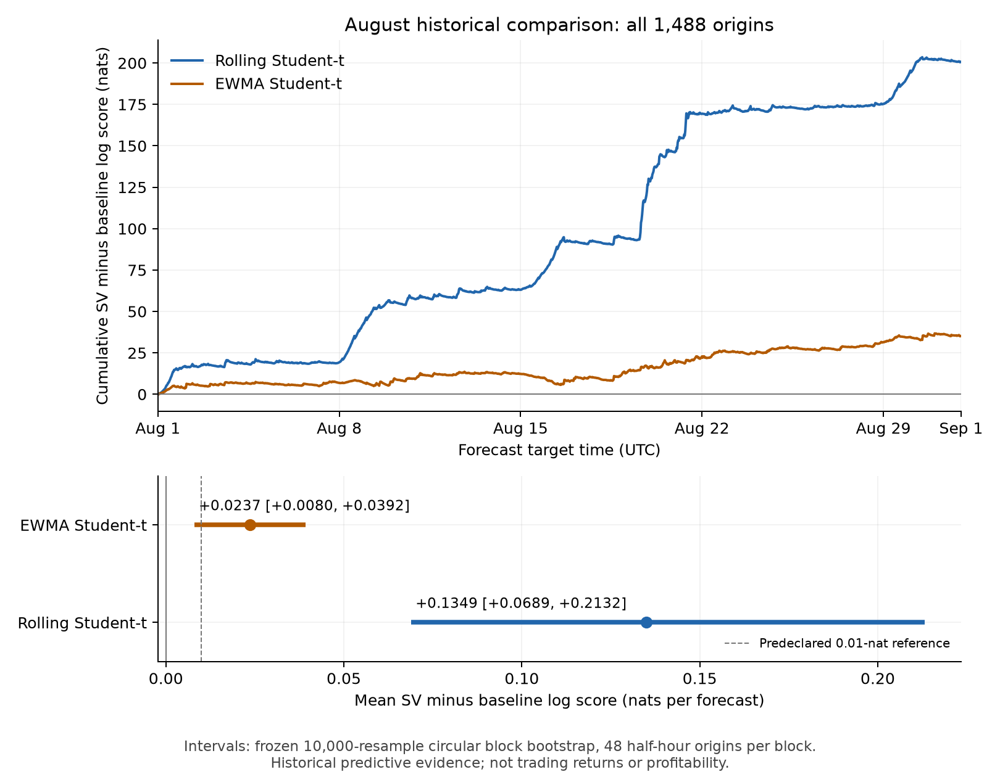

# E62: fixed August historical predictive comparison

The K400 fixed-window SV forecast scored better than both predeclared Student-t5
controls on this complete August 2026 BTC-PERPETUAL half-hour panel. This supports
incremental predictive value on one historical period held out by bounded project
access. It does not establish live availability, future performance or profitable
AMM quotes.

| Paired logscore, nats/origin | Mean | Primary 48-bar block 95% interval |
|---|---:|---:|
| SV minus rolling250 t5 (primary) | 0.134925 | [0.068916, 0.213162] |
| SV minus longer-history EWMA t5 (secondary) | 0.023670 | [0.008011, 0.039173] |

All 1,488 origins and 4,464 arm scores are available, without retries, replacements,
missing scores or threshold changes. The fixed 24/96-bar sensitivity intervals
were [0.076883,0.203197]/[0.063731,0.221625] for rolling t5 and
[0.008849,0.038826]/[0.008150,0.038678] for EWMA. These descriptive circular-block
intervals do not guarantee robustness to longer market dependence or dependence
induced by overlapping 250-return windows. The predeclared 0.01-nat practical
reference is not a qualification threshold: the primary lower endpoint exceeds
it, while the secondary lower endpoint does not. No baseline winner was selected.

The fixed daily summaries favor SV on 26/31 days against rolling t5 and 21/31
against EWMA. Leave-one-day-out means range 0.115745?0.140489 and
0.021689?0.026897 respectively. All these summaries were specified before data
access. There is one market stream, not 1,488 independent market replications.

## Information and causal scope

The calendar month was chosen without inspecting returns, volatility or news.
The bounded metadata exposure audit found no known overlap with July26?August31;
September and October data were already exposed. The acquisition sealed 37 daily
responses/1,776 bars. Exact indexing uses 1,740 closes and 1,739 returns: initial
250 returns, then 1,488 updates and next-return labels. The final label closes at
September1 00:00 UTC. Historical bar-open interpretation and zero-lag close
availability are conventions, not independently verified execution-time feeds;
vendor revisions remain possible.

SV and rolling t5 use the same current 250 returns. EWMA has the same causally
available observations but deliberately retains longer variance memory and its
initial fitted location. This is the frozen E60 comparator, not a matched-window
reset filter. SV forecasts use unpooled current K400 draws. No order flow, inventory,
execution costs, adverse selection, fees or P&L was evaluated.

## Calibration and approximation

SV PIT mean is 0.507177 (48-bar interval [0.496492,0.518432]); second moment is
0.336110 ([0.323474,0.349475]). Its lower/upper 5% tail counts are 53/74 out of
1,488; rolling t5 has 84/106 and EWMA 71/92. SV lag1/lag48 PIT correlations are
?0.075358/0.019050. Marginal moment intervals containing uniform targets do not
prove conditional calibration or serial independence. The frozen summary retains
all histograms, costs, PIT summaries and baseline results.

All eight fixed independent references completed and passed their original gates:
maximum Rhat1.001237, minimum bulk ESS3632.9, minimum tail ESS4247.2, and zero
divergences. Their uncertainty is distinct from across-time predictive uncertainty.

| Tick | Candidate ? reference logscore | Candidate delta MCSE | Reference delta MCSE | PIT difference |
|---:|---:|---:|---:|---:|
| 1 | -0.000116 | 0.003787 | 0.001142 | -0.000308 |
| 213 | 0.000797 | 0.005723 | 0.001119 | 0.003258 |
| 426 | 0.001196 | 0.027112 | 0.001651 | -0.003283 |
| 638 | -0.019943 | 0.017361 | 0.003131 | -0.001520 |
| 851 | -0.063659 | 0.040613 | 0.002147 | -0.000411 |
| 1063 | -0.001587 | 0.005311 | 0.001543 | -0.000943 |
| 1276 | 0.002438 | 0.002917 | 0.000949 | 0.002035 |
| 1488 | -0.002270 | 0.008910 | 0.002158 | 0.000101 |

The largest observed logscore discrepancy is ?0.063659 at tick851, with candidate
MCSE0.040613 versus reference0.002147. Eight spots cannot certify the entire
path, and short-chain MCSE is a diagnostic, not an accuracy stopping rule. The
measured K400 forecast advantage must not be silently relabeled an exact-posterior
advantage. No reference replaced an observed candidate score.

All 1,488 candidate GH64/128 comparisons passed unchanged tolerances: maximum
aggregate logpdf difference1.78e-15 and PIT difference3.33e-16, with zero CDF
roundoff clips. Native telemetry covers2,380,800 transitions: zero divergences,
nonfinite energy errors or zero-density evaluations; maximum depth7. Raw stop
codes were0:1,205,689 (outer U-turn),1:1 (recursive U-turn),4:1,175,110
(reverse-coarser accepted). Maximum finite absolute proposal energy error was
15.63974; zero divergence flags do not mean every proposal had tiny error.

## Practical cost and integrity

| Observed-return forecast work | Median seconds | p95 seconds | Maximum seconds |
|---|---:|---:|---:|
| SV native update + logpdf/PIT evaluation | 0.389039 | 0.513675 | 0.570908 |
| Rolling t5 fit + score | 0.004859 | 0.006409 | 0.008811 |
| EWMA update + score | 0.000166 | 0.000186 | 0.000393 |

SV's whole candidate phase took560.66s, including4.08s initialization and31.18s
measured record I/O; its native/scoring totals were483.48/27.81s. The whole
11-job campaign took744.06s with2.084GB sampled peak owned RSS and232.77MB
outputs. These are measured CPU timings on the AWS host, not GPU acceleration,
full predictive quantiles or complete application latency. The cheap controls
remain substantially cheaper. Sampling/scoring was isolated from other research
compute; archive compression finished before the subsequent long campaign.

The first readiness binder failed before sampling because a source helper was
omitted from its bundle. The unchanged helper was added with explicit approval,
and the complete fixed literal replay then passed. That infrastructure history
is preserved separately; the scientific campaign itself ran once. All11 production
jobs completed; supervisor exit0, execution_complete and all forecast counts were
checked separately from accounting completeness. Every owned process group drained.

Authorized manifest SHA256:
`63ab048069d36a55146ab6e93ecc3eea7234887637086fbdad842b698c928749`.
Frozen summary SHA256:
`5845f7802dd97852b8a09271136a5a9887c21f8a86afc4ecba93b55c41fde608`.
Full archive SHA256:
`309d1b61688d7c30bbb10ec0b474793f8752a9b24eae2492c1bb429a395481d7`.
All14,025 archived file hashes verified locally; the original authorized manifest
pre/post hash held. The frozen report also verified5,992 artifact references.
Archive: `C:/dev/owalnuts/target/fresh-real-production-20261027-evidence.tar.gz`.
Local expanded evidence: `C:/dev/owalnuts/target/fresh-real-production-verified-20261027/fresh-real-readiness-20261027`.
See [plan](PLAN-DRAFT.md), [exposure audit](EXPOSURE-AUDIT.md),
[readiness history](execution-20261027/READINESS-RESULT.md), and
[frozen summary](execution-20261027/production-metadata/campaign01--campaign--summary.json).

Independent review recomputed all archive checksums and all arm/paired means
from the unique contiguous 1,488-origin ledger, finding no integrity or
accounting blocker. No additional outcome-selected statistical tests were run.
