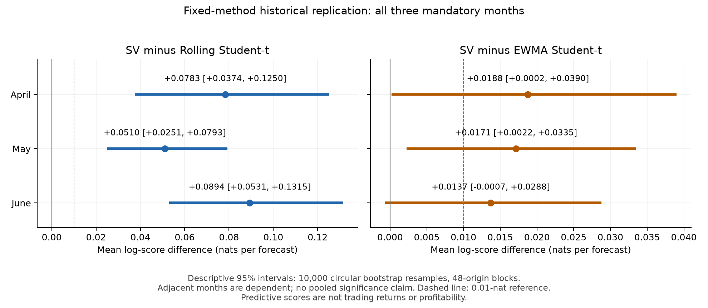

# E64: fixed April, May and June predictive replication

The unchanged K400 SV forecast repeated its advantage over the rolling Student-t5
baseline in all three mandatory historical panels. Gains over the more adaptive
EWMA Student-t5 control were smaller: April's 48-bar EWMA interval barely excludes
zero, and June's includes zero. This extends E62's predictive-value evidence to
three additional calendar periods. It does not establish independent-regime
replication, live profitability or deployment readiness.

All 4,368 origins, 13,104 arm scores and 24 independent reference slots completed.
All 33 jobs exited zero; the external supervisor drained every owned process.
There were no replaced origins, missing scores, retries, relaxed gates or
outcome-selected months. The frozen plan and numerical methods remained unchanged.

## Fixed predictive comparisons

The primary interval uses 10,000 paired circular bootstrap draws with 48 half-hour
bars per block. The 24- and 96-bar sensitivity intervals were also fixed before
acquisition. Values below are nats per forecast, SV minus the named baseline.

| Month | Comparator | Mean | Primary 48-bar interval | 24-bar interval | 96-bar interval |
|---|---|---:|---|---|---|
| April | Rolling250 t5, primary | 0.078291 | [0.037416, 0.125034] | [0.043319, 0.117339] | [0.033553, 0.129380] |
| May | Rolling250 t5, primary | 0.051015 | [0.025077, 0.079296] | [0.026822, 0.076671] | [0.022830, 0.082128] |
| June | Rolling250 t5, primary | 0.089356 | [0.053054, 0.131516] | [0.054945, 0.130290] | [0.047475, 0.143309] |
| April | EWMA t5, secondary | 0.018764 | [0.000183, 0.039000] | [0.001294, 0.037805] | [0.001247, 0.037017] |
| May | EWMA t5, secondary | 0.017147 | [0.002227, 0.033501] | [0.002085, 0.033514] | [0.002861, 0.032906] |
| June | EWMA t5, secondary | 0.013710 | [-0.000677, 0.028775] | [-0.000275, 0.028612] | [-0.000706, 0.029464] |

The origin-weighted aggregate means are 0.072647 against rolling t5 and 0.016547
against EWMA. These are descriptive only: no pooled interval, p-value or
independent-month meta-analysis was computed. Per-month intervals are not a
family-wise replication decision. Adjacent markets, overlapping context and
250-return windows can induce dependence beyond the specified blocks. The
predeclared 0.01-nat practical reference is context, not a qualification gate;
all rolling-t5 lower endpoints exceed it, while all EWMA lower endpoints do not.

Daily gains against rolling t5 were positive on 20/30, 21/31 and 26/30 days;
against EWMA, 17/30, 21/31 and 17/30. Frozen leave-one-day-out means stayed
positive: rolling ranges 0.063804 to 0.082586, 0.043650 to 0.054598, and
0.078809 to 0.093100; EWMA ranges 0.013184 to 0.022552, 0.014269 to 0.019054,
and 0.010932 to 0.015803. All daily, cumulative and leave-one-day-out values are
retained in the original summaries; no favorable subset was selected.

## Data, information and causal scope

April, May and June 2026 were selected by calendar before outcomes, using a
bounded acquisition-metadata exposure audit that found no known March 26 through June 30
project acquisition. The audit excludes external accounts, browser histories,
unrecognized provenance and unexpanded archives; it cannot certify globally
unseen data. These are historical periods held out by project access, not a
prospective live holdout. E62's July 26 through August 31 context/data and later September
and October development periods were already exposed.

One sealed acquisition supplied 97 full UTC days and 4,656 Deribit BTC-PERPETUAL
30-minute traded bars. Exact panels contain 1,440/1,488/1,440 consecutive forecast
origins. Each model and baseline independently initializes from its declared
250 returns. The final labels close at May 1/June 1/July 1 00:00 UTC. At tick t,
SV and rolling t5 fit y[t:250+t], while EWMA retains its declared causal history;
all arms score y[250+t]. No future label enters a fit.
May and June initialization overlap earlier planned panel observations. No
posterior or EWMA state crosses panel boundaries, but market dependence remains.
Historical bar-open timestamps and close availability at open plus 30 minutes
retain E62's conventions; publication delay and vendor revisions were not audited.

SV and rolling t5 choose the same current 250-return window. EWMA uses the same
causally available observations but retains its initial location and variance
memory from that month's start. Exact E62 priors, native target/remapping,
initial guard, K400/four chains, GH64/128 scoring, rolling t5 optimizer and
lambda 0.94 EWMA settings were reused. Forecasts are unpooled current posterior
draws, with no new model, speed or adaptation tuning.

## PIT and approximation diagnostics

| Month | SV PIT mean [48-bar interval] | Second moment [48-bar interval] | Lower/upper 5% tails | Central 90 count | PIT lag1 / lag48 correlation |
|---|---|---|---|---:|---|
| April, N=1440 | 0.503537 [0.491254, 0.515508] | 0.332789 [0.318540, 0.346812] | 53 / 57 | 1330 | -0.015535 / 0.005133 |
| May, N=1488 | 0.496705 [0.485667, 0.507578] | 0.326272 [0.315297, 0.337337] | 69 / 54 | 1365 | -0.023276 / 0.018055 |
| June, N=1440 | 0.489743 [0.474857, 0.504887] | 0.321085 [0.307908, 0.334308] | 75 / 62 | 1303 | -0.012009 / -0.044084 |

Central 90 empirical coverage is approximately 92.36%, 91.73% and 90.49%.
Marginal moments near uniform targets do not establish conditional calibration
or independence. Rolling t5 tail counts are 77/86, 88/68 and 104/95; EWMA counts
are 77/66, 85/69 and 83/79. All ten PIT bins and all baseline moment/interval/serial
summaries are in the frozen monthly reports, not omitted when less favorable.

All 24 references passed the unchanged gates: overall maximum Rhat 1.001980,
minimum bulk ESS 3805.13, minimum tail ESS 4585.92 and zero reference divergences.
Each reference used four chains, 2,000 warmup and 4,000 retained draws per chain.

| Month | Largest absolute candidate-reference logscore difference | Largest PIT difference | Candidate log-density MCSE range | Reference log-density MCSE range |
|---|---:|---:|---|---|
| April | 0.012625 | 0.002836 | 0.004432 to 0.012752 | 0.001363 to 0.002869 |
| May | 0.008637 | 0.001775 | 0.003170 to 0.007412 | 0.001014 to 0.001852 |
| June | 0.008644 | 0.001616 | 0.002735 to 0.015126 | 0.000787 to 0.004141 |

[All 24 reference comparisons](REFERENCE-COMPARISONS.md) retain signed differences
and both candidate-own and long-reference delta-density/PIT MCSE. The largest
observed logscore difference is -0.012625 at April tick 1440, with candidate
MCSE 0.006849 and reference MCSE 0.001809. Eight spots per month do not certify the
whole path; short-chain MCSE is diagnostic, not a stopping rule. The tested K400
forecast advantage cannot be silently relabeled an exact-posterior advantage.
No long reference replaced a candidate forecast or altered the reported gains.

All 4,368 candidate GH checks passed unchanged tolerances: maximum aggregate
logpdf difference 1.78e-15 and PIT difference 4.44e-16, with zero roundoff clips.
Across 24 references, maxima were 3.55e-15 and 2.22e-16 respectively. These checks
validate the frozen numerical integration comparison, not the market model.

## Initialization, guard and subsequent native health

Initial warmup is reported separately from retained draws and rolling updates.
Each month recorded four guard checks and zero restarts, with complete telemetry
and no chain warnings. Initial discarded work consisted of 4,000 transitions per
month, with 12 divergences and 32 zero-density evaluations (also recorded as 32
recoverable target failures). There were 482/516/535 maximum-depth stops in
April/May/June. Each chain's warmup array recorded
three divergences. These adaptation events are preserved, not hidden behind the
subsequent zero-divergence summaries. Discarded work can include abandoned attempts
in general; none of these initial guards restarted.

Each month's 800 initial retained transitions had zero divergences, recoverable
target failures, zero-density evaluations and maximum-depth stops. Subsequent
rolling updates covered 2,304,000/2,380,800/2,304,000 transitions with no missing
health fields, divergences, nonfinite energy errors or zero-density evaluations.
Maximum depths were 7/7/9; maximum finite absolute proposal energy errors were
2.803180/1.119200/0.999992. Zero divergence flags do not mean every proposal
had negligible energy error. Full stop-code counts and work totals are retained
in the compact audit and original evidence.

## Practical cost

| Month | SV update + observed-return score median / p95 / max seconds | Rolling t5 median seconds | EWMA median seconds | Whole candidate phase seconds |
|---|---|---:|---:|---:|
| April | 0.498082 / 0.512688 / 0.644845 | 0.004881 | 0.000163 | 724.49 |
| May | 0.500746 / 0.513108 / 0.612687 | 0.004714 | 0.000162 | 792.77 |
| June | 0.511570 / 0.523395 / 0.664289 | 0.004816 | 0.000165 | 786.54 |

Initial native fits took 4.00/4.73/4.89 seconds, with measured record I/O
30.87/31.50/30.10 seconds. Three candidate processes ran concurrently on disjoint
four-core CPU sets but shared memory/cache/I/O; these are not isolated E62 timing
comparisons. Baselines ran subsequently in serial phases. The full 33-job batch took 1,370.84 seconds (22.85 minutes), sampled
peak owned RSS 2,108,350,464 bytes and 701,334,267 bytes of outputs. All processes
drained. The AWS instance was stopped after verified archival.

The cheap baselines remain much cheaper. Candidate timings include native updates
and observed-return logpdf/PIT arithmetic, excluding initialization and persistence
from the per-origin column. They do not measure full predictive quantiles, trading
quotes or complete application latency, and no GPU acceleration is claimed.
No order-flow, fees, inventory, adverse-selection, execution or P&L experiment was
performed. These forecast results do not establish a profitable AMM or resolve
separate long-run reliability limitations recorded in E63.

## Reproducibility and bounded evidence

The scientific plan was frozen before the 97-request acquisition. The separately
frozen literal engineering replay passed all four stages, eight ops fixtures and
one reference, using deliberately reused development seeds and no market data.
The scientific campaign ran once under unchanged source/runtime/data/seed pins.
The reporting helper ran only after terminal sealing and archive verification;
it recomputed every arm/paired mean from complete ledgers without rerunning
scores, bootstrap draws or inference. Parent independently reproduced all six
paired means and verified all 40,648 archived file hashes.

Authorized production manifest SHA256:
`1a6c25d68202d1172569dbcb922b5a5d7a6e408615b1e4b3db5c4ba1dd7e340d`.
Full archive SHA256:
`da1e3025d746e6b7984fef03c7bf55afeb6963274edba46f697aaac80c993f6d`.
Archive size: 496,480,024 bytes.

The full local archive is stored at `C:/dev/owalnuts/target/market-replication-20261027-evidence.tar.gz`.
Verified expansion:
`C:/dev/owalnuts/target/market-replication-verified-20261027/market-replication-20261027`.
The compact Git packet contains frozen summaries, complete score ledgers with
original-ledger hashes, terminal/reference comparisons, source/runtime identities,
archive inventory and audit metadata. Raw market responses, posterior arrays and
native diagnostic trees remain in that verified archive/expansion, not duplicated
in Git. Pending/readiness manifest identity records point to their exact originals.

See the [frozen plan](PLAN-DRAFT.md), [bounded exposure audit](EXPOSURE-AUDIT.md),
[April summary](execution-20261027/2026-04/summary.json),
[May summary](execution-20261027/2026-05/summary.json),
[June summary](execution-20261027/2026-06/summary.json), and
[postrun audit](execution-20261027/POSTRUN-AUDIT-SUMMARY.json).
