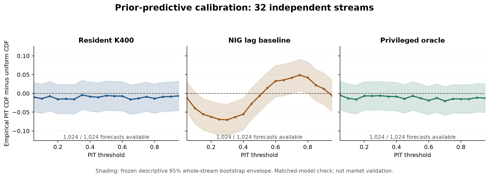

# Prior-predictive validation: complete short-run calibration evidence

All32 independent, untruncated prior-predictive streams completed their32 fixed-window residentK400 updates:1024/1024 candidate forecasts,1024/1024 baseline forecasts and1024/1024 privileged-oracle forecasts. All eight separately compiled independent posterior references completed and met the frozen reference reliability criteria. The73-job campaign finished in806.09seconds, with2.041GB peak sampled RSS and no execution/resource failures. All owned processes drained; AWS is stopped.

The results support the current implementation over these short, matched-model streams. They do not establish market profitability, superiority to strong rolling Student-t/EWMA baselines, long-horizon stability or deployment readiness. WP96's long-horizon drift/re-adaptation failures remain unresolved.

## Calibration and predictive scores

Uncertainty uses the frozen10000 resamples of32 whole independent streams, preserving all32 dependent origins within each cluster. No origin or chain was excluded and no new qualification gate was introduced.

| Frozen endpoint | Estimate |95% stream-cluster interval |
|---|---:|---:|
| Candidate PIT mean (uniform target0.5) |0.51039 |[0.49370,0.52796] |
| Candidate PIT second moment (uniform target1/3) |0.34317 |[0.32537,0.36207] |
| Candidate logscore minus NIG baseline, nats |+0.15458 |[+0.08527,+0.24145] |
| Candidate logscore minus privileged oracle, nats |−0.04484 |[−0.06582,−0.02572] |

Candidate lower/upper5% PIT tails contain41/1024 and58/1024 labels; no PIT equals0 or1. The maximum discrepancy on the fixed19-point PIT grid is0.01621, inside the existing descriptive simultaneous band radius0.03906. The oracle's grid band also contains uniformity. The NIG baseline's grid discrepancy0.07051 exceeds its radius0.04199. These are the frozen descriptive outputs, not post-hoc hypothesis tests.

The generator is SV with exactly the inference target's priors. Accordingly, better scores than the simpler NIG model are useful implementation evidence and cannot establish incremental market value. The oracle uses true parameters and only the CURRENT latent state, integrating the next innovation; it does not condition on the future latent value.

## Independent posterior corroboration

All8 references retain four chains×4000 draws, with zero retained divergences, maximum rankRhat1.000705, minimum bulkESS6009.6 and minimum tailESS6855.4. Reference PIT MCSE is at most0.0003557; delta log-predictive-density MCSE is at most0.002192. All meet the frozen reliability thresholds.

The table reports candidate minus reference. MCSE pairs are candidate/reference, computed from each method's own chain/draw integrated densities or CDF values. Logscore uncertainty targets log(mean density), not mean(logdensity).

| Stream,tick | PIT difference | PIT MCSE pair | Logpdf difference (nats) | Logpdf MCSE pair |
|---|---:|---:|---:|---:|
|0,1 |+0.000235 |0.000852/0.000246 |+0.000077 |0.003320/0.000991 |
|4,32 |+0.000617 |0.000879/0.000296 |−0.001665 |0.002975/0.000970 |
|8,1 |+0.000936 |0.001207/0.000356 |−0.003042 |0.004480/0.001460 |
|12,32 |−0.000804 |0.000934/0.000273 |+0.001824 |0.002447/0.000644 |
|16,1 |−0.000705 |0.000925/0.000245 |+0.001241 |0.003969/0.000956 |
|20,32 |−0.000276 |0.000870/0.000265 |+0.001345 |0.004317/0.001266 |
|24,1 |−0.000032 |0.000930/0.000242 |−0.006495 |0.006268/0.001782 |
|28,32 |+0.000891 |0.000429/0.000160 |−0.013733 |0.006311/0.002192 |

The largest absolute discrepancy is0.0009365 PIT and0.013733nats logpdf. The latter has candidate MCSE0.006311 and reference MCSE0.002192. No new two-standard-error pass rule is applied; eight spot checks cannot certify all1024 posterior approximations.

## Native sampler health: retained samples and warmup separated

Supplemental accounting of existing native telemetry finds zero divergences among all1,638,400 retained warm transitions and all25,600 initial retained transitions. Retained phases also have zero maximum-depth, refinement-exhaustion, invalid-evaluation, recoverable-target, zero-density or nonfinite-position events. Raw transition arrays agree with the native work counters. Warm stop codes are1,552,580 outer U-turn,10,098 recursive U-turn and75,722 reverse-coarser accepted stops.

Warmup was not event-free: its128,000 discarded transitions contain365 divergences,12,771 maximum-depth stops,364 refinement-exhaustion stops and1024 recoverable zero-density evaluations. These remain in the evidence and did not persist into retained phases. Native initial-chain warnings are empty; the declared automatic initial guard performed128 checks and zero restarts. There were no ad-hoc reruns or replacements. Finite forecasts alone would not establish healthy MCMC; these diagnostics are reported separately.

## Supplemental cost accounting

All timings below retain their complete planned denominators. These are descriptive operational summaries, separate from the frozen predictive/bootstrap analysis.

| Component | Count | Median |P95 |Maximum |
|---|---:|---:|---:|---:|
| Native initialization fit |32 |2.121s |3.181s |4.574s |
| Warm update plus observed-label scoring |1024 |0.2571s |0.5105s |1.0478s |
| Native sampling within update |1024 |0.2414s |0.4868s |0.9702s |
| Observed-label evaluator within update |1024 |0.01664s |0.02940s |0.09460s |
| Whole candidate job,32 updates |32 |16.450s |25.149s |41.949s |
| Whole independent-reference job |8 |21.084s |21.630s |21.751s |

Per-update totals include preparation, sampling and PIT/logpdf evaluation, but exclude initialization, persistence, imports and integrity checks. Whole-job timings include those costs. Native-initialization timing excludes subsequent diagnostic-summary and session-construction overhead. The candidate phase totals533.17s, side scoring96.79s, references169.55s and reporting2.94s; the complete external envelope is806.09s. No quantile roots are computed here, so these timings are not complete return-quantile update latency.

## Protocol and immutable evidence

[Final scientific protocol](PROTOCOL-FINAL.md), [authorized manifest](execution-20261027/MANIFEST-AUTHORIZED.json), [launch record](execution-20261027/LAUNCH.json), and [frozen summary](execution-20261027/evidence/prior-predictive-validation-20261027/campaign01/campaign/summary.json) specify the design and complete result. [Native health](execution-20261027/NATIVE-HEALTH-SUPPLEMENT.json) and [latency](execution-20261027/LATENCY-SUPPLEMENT.json) supplements add descriptive accounting without changing the frozen analysis.

The sole campaign started2026-10-27 at19:31:32UTC with the fixed32-stream schedule, no retries/replacements/tuning,2880s internal/3000s external cap,4GiB sampled RSS and1GiB output cap. The authorized manifest differs from the reviewed pending manifest only in status. Its SHA256 is `926a0b2b75c7f068ee218d1d6354d8e9947cf64d3a710fc4d8a0ce462fe657a8`; it remained unchanged. All18,745 source/runtime bindings matched after execution.

The126,323,007-byte archive has SHA256 `16854d8642d9df2e143e25b02dfc409329d85214c288a02d3fd37fd9b9e1378d`. All2466 packet file hashes were independently verified after local extraction. The archive remains at `C:/dev/owalnuts-wt/warm-precision/target/prior-predictive-validation-20261027-evidence.tar.gz`; the complete extracted packet remains under `execution-20261027/evidence/prior-predictive-validation-20261027`. Numerical arrays/native binaries/cache files are intentionally excluded from Git but remain in that verified packet and archive. Metadata, reports, frozen source bytes and checksums are committed; no raw files were discarded.

One earlier literal engineering smoke failed while serializing a bound warning method; its preserved development packet is separate. The corrected wrapper calls the method and stores its records. That repair changed no sampler settings and consumed no study data or reserved study seeds.
